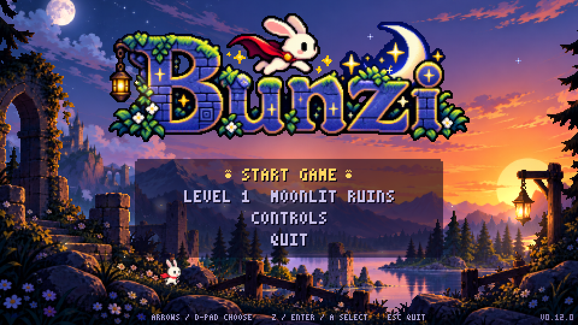
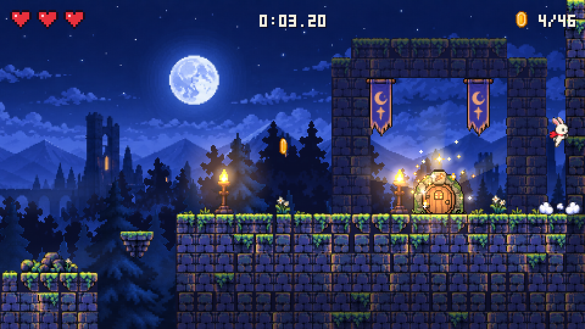
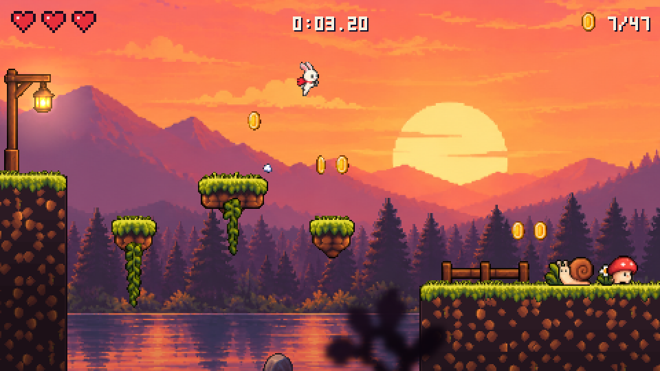
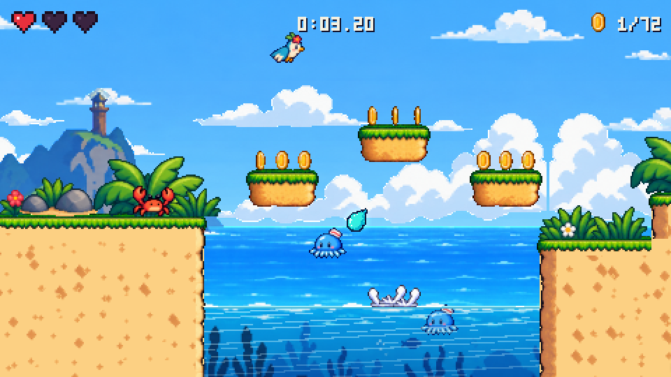
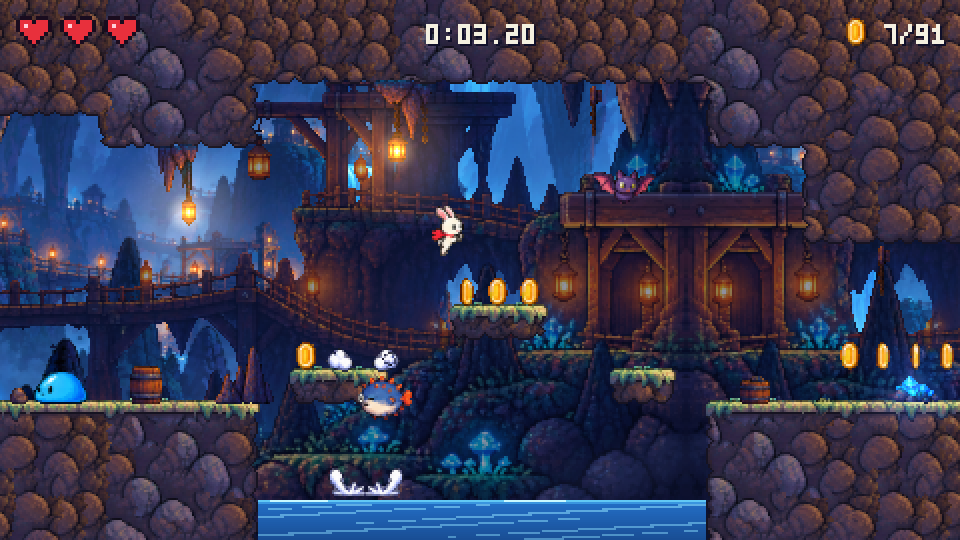
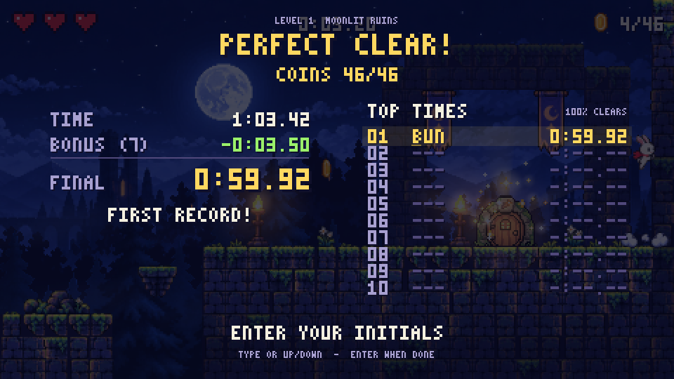
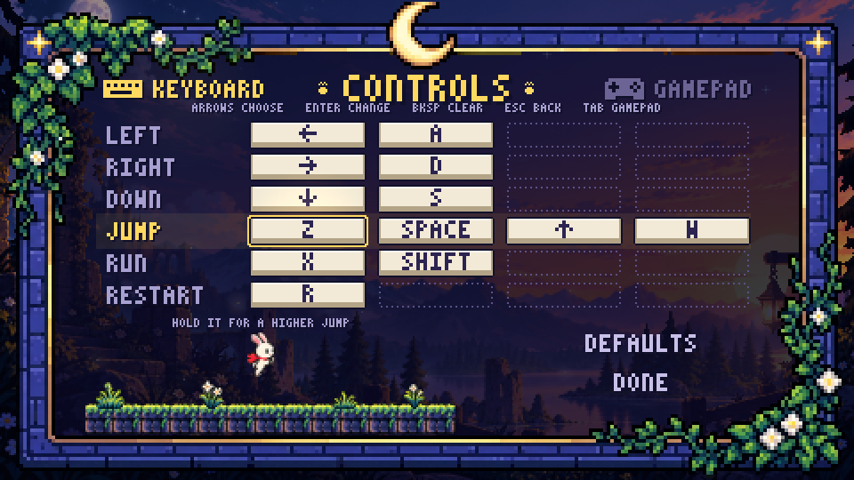

# Bunzi


https://github.com/user-attachments/assets/fd954965-02c6-44a9-941b-693f6f6c179e


A colourful pixel-art bunny platformer played **inside your terminal**.
Explore four levels, collect every coin and chase your best time. Stomping
enemies takes time off the clock, so the fastest route means choosing your
battles.



https://github.com/user-attachments/assets/1cb55597-6392-4397-a992-9265da2c5adc

Version: 0.12.1 · Linux x86_64 · needs the [kitty](https://sw.kovidgoyal.net/kitty/) terminal

## Play it

**Download (easiest):** get `Bunzi-<version>-x86_64.AppImage` from the
[latest release](https://github.com/subbaan/bunzi/releases/latest). It is one
file holding the game, its art and sounds, and the libraries it needs, and runs
on Linux systems from about 2022 on (glibc 2.35+; Ubuntu 22.04, Debian 12,
Fedora 36, Arch …). Open **kitty** and run:

```sh
chmod +x Bunzi-*-x86_64.AppImage
./Bunzi-*-x86_64.AppImage
```

If it complains about FUSE, run it with `--appimage-extract-and-run`. Options
such as `--level 3` pass straight through.

**Build from source:**

```sh
git clone https://github.com/subbaan/bunzi.git
cd bunzi
make            # builds build/bunzi and symlinks ./bunzi
./bunzi         # run inside kitty
```

Building needs a C compiler with GNU C11 support, Make, pkg-config, and the
SDL3, libpng and zlib development packages:

```sh
sudo pacman -S base-devel sdl3 libpng zlib                     # Arch
sudo apt install build-essential pkg-config libsdl3-dev libpng-dev zlib1g-dev  # Debian 13, Ubuntu 25.04+
sudo dnf install gcc make pkgconf-pkg-config SDL3-devel libpng-devel zlib-devel  # Fedora 42+
```

Older releases such as Ubuntu 24.04 LTS and Debian 12 don't package SDL3, so
use the AppImage there (or build SDL3 yourself). The release tarball
(`bunzi-<version>-linux-x86_64.tar.gz`) has the same needs at run time.

**Terminal:** Bunzi draws with kitty's graphics and keyboard protocols and is
tested in kitty. Ghostty supports the same protocols but is untested. Other
terminals won't work.

## Levels

1 Moonlit Ruins (night), 2 Sunset Lake (dusk), 3 Tropical Island (day),
4 Crystal Caverns (underground). The game opens on the title screen (start,
level choice, controls, quit) with its own SID-style tune; Esc in a level
returns to it.

| | |
|---|---|
|  |  |
|  |  |
|  | |

## The goal

Reach the burrow door at the end of each level, ideally with **every coin**,
as fast as you can.

- The clock starts with your first move and shows hundredths.
- Each enemy you stomp takes **0.5 s** off the clock (a green `-0.5S` pops up and
  the clock flashes). Whether a far-off enemy is worth the detour is up to you.
- Taking damage costs nothing but the knockback; losing all three hearts
  restarts the level and the clock.
- The results screen shows the time, the bonus and the final time, then offers
  **Retry**, **Next level** and **Title**.
- Only a **perfect clear** (all coins) can enter the level's **local Top 10**
  (kept on your machine in `~/.local/share/bunzi/`; there is no online
  leaderboard). Enter three initials (type them, or up/down; Enter when done).
  The last ones you used come pre-filled.

Water enemies:
- **Spiky fish** (level 4) trail you under the surface, leap on a beat (bubbles
  give it away) and snap up at you as you jump over their pool. Each needs a
  moment between leaps, so cross just after one.
- **Jellyfish** (level 3) squirt water at you, aiming where you're heading.

## Controls

| Action | Keyboard | Gamepad |
|---|---|---|
| Move | arrows / A D | d-pad / left stick |
| Jump (hold = higher) | Z / space / up / W | A |
| Run | X / shift | X / RB / RT |
| Drop through platform | down + jump | down + A |
| Restart level | R | Back |
| Results: choose / select | arrows, WASD / Z, space, enter | d-pad / A |
| Mute sound | N | |
| Back to the title | Esc / Q | Back + Start |
| Title: choose / select | arrows, WASD / Z, space, enter | d-pad / A, start |
| Title: quit | Esc / Q | B or back (to QUIT) |

The keys and buttons above are the defaults. To change them, choose
**CONTROLS** on the title screen: pick a slot with the arrows, press Enter,
then press the new key (Backspace clears a slot, Esc goes back). Each action
takes up to four keys, and the bunny shows what the chosen one does. Giving a
key to one action takes it from another, swapping keys where it can.

The gamepad has its own page (Tab, or LB / RB on the pad; it opens there when
you choose CONTROLS with the pad). Press A on a slot, then the new button. Y
clears a slot, and B goes back; while it waits for a button, a tap of B
binds B and holding it cancels. The face buttons and d-pad are drawn by
position, so the pictures match any make of pad. The left stick always moves,
and the menus keep the d-pad, A, B and Start.

Your keys and buttons are saved in `~/.config/bunzi/controls.txt` (or
`$XDG_CONFIG_HOME/bunzi/`). Esc always works, and a shortcut such as N (mute)
or Start (debug overlay) stops being a shortcut once an action has it.



When started with `--level N` the title screen is skipped, so Esc / Q quits.
Debug keys and developer options are in
[docs/DEVELOPMENT.md](docs/DEVELOPMENT.md); `./bunzi --help` lists everything.

## Troubleshooting

If the game fails to display or keyboard movement doesn't work, run
`./bunzi --probe` inside your terminal: it reports graphics, keyboard and
shared-memory support. Please include its output, `./bunzi --version`, your
distribution and your terminal's version in an
[issue](https://github.com/subbaan/bunzi/issues).

## Art and sound

The level, title and creature art was painted with ChatGPT image generation
and converted to hard-edged pixel art; the exit door and water effects were
made with SpriteCook. All sound effects and music are synthesized in code.

## Licence

MIT, see `LICENSE`.
